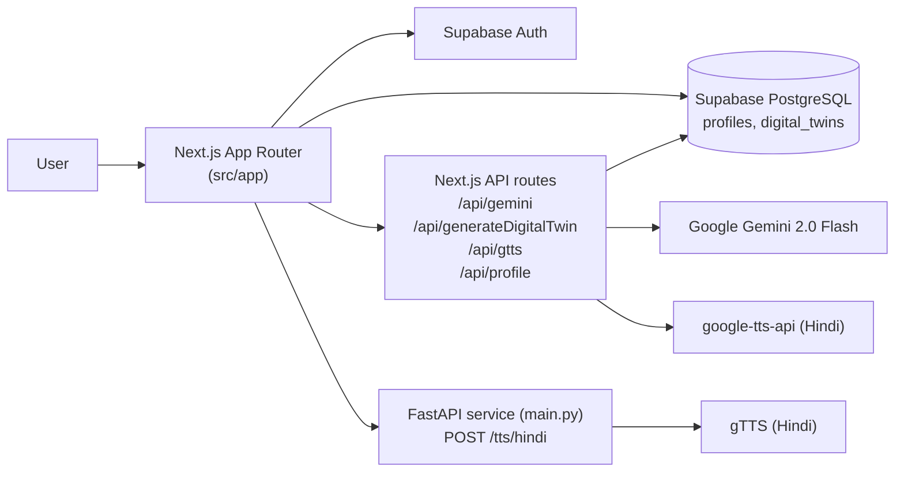

# MaatriMtra-AI

> AI-powered maternal & child health companion — personalised nutrition and health guidance, in English and Hindi, built for expecting mothers and their families.

MaatriMtra AI (मातृमित्र AI) is a web app that turns a mother's basic health information into a personalised health plan — a "Digital Twin" — with diet guidance, health tips, risk prediction and child nutrition advice, plus Hindi voice guidance for low-literacy users.

> ⚠️ **Disclaimer:** This app is not a replacement for a doctor. It provides general health guidance only.

## 🔗 Live Demo

> **TBD — no live demo link has been verified yet.** Add the deployed URL here once the app is deployed.

## 📸 Screenshots


> The images above are the app's own hero and form images from `public/photos/`. Add more screenshots (dashboard, health plan, chat) here once available.

## 🧱 Tech Stack

| Layer | Technology |
|---|---|
| Frontend | Next.js 15.3.3 (App Router), React 19, TypeScript, Tailwind CSS 4 |
| UI | Radix UI, lucide-react, `next-themes` (light/dark) |
| Auth & Database | Supabase (Auth + PostgreSQL) — tables: `profiles`, `digital_twins` |
| AI | Google Gemini 2.0 Flash (`@google/generative-ai` / Gemini REST API) |
| Voice / TTS | `google-tts-api` (Hindi, in-app), gTTS via a small Python FastAPI service (`main.py`) |
| Python service | FastAPI + gTTS (`main.py`, `generate_intro_audio.py`) |

## ✨ Key Features

- **Bilingual (English / Hindi)** — full UI in both languages, switchable from the footer.
- **Personalised Digital Twin** — fill in age, pregnancy week, health conditions, meals and supplements, and Gemini generates a personal health plan.
- **Personalised diet plan** — morning / afternoon / dinner suggestions from the Digital Twin.
- **Health tips & risk prediction** — weekly tips and a risk level in the generated plan.
- **Child nutrition guidance** — advice per child age, including breastfeeding guidance.
- **Learn through stories** — story-based health learning.
- **Hindi voice guidance** — audio guides for users with low literacy (`/api/gtts`, pre-recorded Hindi/English help audio in `public/audios/`).
- **Auth, profile & dashboard** — Supabase sign-up/login, create-profile flow, dashboard showing the saved health plan.
- **Light/dark theme** and a splash screen that routes signed-in users to their dashboard or profile setup.

## 🏗️ Architecture



Flow: user signs up → creates a profile (`/create-profile`) → `POST /api/generateDigitalTwin` sends the profile to Gemini, parses the JSON plan, and upserts it into `digital_twins` → the dashboard (`/dashboard`) reads the profile and twin data back from Supabase.

## 🚀 Installation

### Prerequisites

- Node.js 18+ and npm
- A Supabase project, and a Google Gemini API key
- Python 3.10+ (only if you want to run the FastAPI TTS service)

### Steps

```bash
git clone https://github.com/aadityaa29/MaatriMtra-AI.git
cd MaatriMtra-AI
npm install
```

Create a `.env.local` file (see below), then run:

```bash
npm run dev
```

Open [http://localhost:3000](http://localhost:3000).

To run the Python TTS service (optional):

```bash
pip install fastapi gtts
uvicorn main:app --reload
```

> Note: there is no `requirements.txt` in the repo yet — the Python dependencies above are the ones imported in `main.py`.

Other useful commands:

```bash
npm run build   # production build
npm start       # start the production server
npm run lint    # lint
```

## 🔐 Environment Variables

Create a `.env.local` file in the project root with:

```env
# Gemini (server-side, used by /api/gemini and /api/generateDigitalTwin)
GEMINI_API_KEY=your_gemini_api_key

# Supabase (used by the app and the API routes)
NEXT_PUBLIC_SUPABASE_URL=your_supabase_project_url
NEXT_PUBLIC_SUPABASE_ANON_KEY=your_supabase_anon_key

# Supabase service role key (server-side only — never expose it in the browser)
SUPABASE_SERVICE_ROLE_KEY=your_supabase_service_role_key
```

These are the exact variable names read in the code (`src/app/api/*`, `src/utils/supabase/*`). Never commit real keys — `.env.local` is git-ignored.

Supabase tables used by the app: `profiles` (user_id, age, pregnancy_stage, weight, health_conditions, local_foods, language_preference) and `digital_twins` (user_id, profile_id, twin_data, updated_at).

## 📡 API Documentation

All API routes are Next.js route handlers under `src/app/api/`, plus one FastAPI endpoint in `main.py`.

### `POST /api/gemini`

Generic Gemini proxy.

- **Request:** `{ "prompt": "string" }`
- **Response:** the raw Gemini `generateContent` JSON for model `gemini-2.0-flash`.
- **Requires:** `GEMINI_API_KEY`.

### `POST /api/generateDigitalTwin`

Generates the personalised Digital Twin plan and saves it to Supabase.

- **Request:** `{ "profile": { "user_id": "...", "id": "...", "age": 25, "pregnancy_week": 20, "health_conditions": "anemia" } }`
- **Response:** the generated plan JSON, e.g. `{ "focus": "...", "weekly_tip": "...", "risk_level": "...", "diet_plan": { "morning": "...", "afternoon": "...", "dinner": "..." }, "child_nutrition": { "age": "...", "advice": "...", "breastfeed": "..." }, "tasks": ["...", "..."] }`
- **Side effect:** upserts the plan into the `digital_twins` table (on conflict: `profile_id`).
- **Errors:** `400` if no profile is sent, `500` if the Gemini key is missing or Gemini returns invalid JSON.
- **Requires:** `GEMINI_API_KEY`, `NEXT_PUBLIC_SUPABASE_URL`, `SUPABASE_SERVICE_ROLE_KEY`.

### `POST /api/gtts`

Returns Hindi speech audio for a given text.

- **Request:** `{ "text": "string" }`
- **Response:** `audio/mpeg` bytes (Hindi, via `google-tts-api`).

### `POST /api/profile`

Creates or updates a user profile in Supabase.

- **Request:** `{ "user_id": "...", "age": 25, "pregnancyStage": "...", "weight": 60, "healthConditions": "...", "localFoods": "...", "language": "hi" }`
- **Response:** `{ "message": "Profile saved successfully" }`
- **Errors:** `400` if `user_id` is missing, `500` on a Supabase error.

### `POST /tts/hindi` (FastAPI service, `main.py`)

Generates Hindi TTS audio with gTTS.

- **Request:** `{ "text": "string" }`
- **Response:** `audio/mpeg` file (`plan_hi.mp3`).
- **Errors:** `400` if no text is sent, `500` on a gTTS error.

## 🔮 Future Improvements

- Deploy the app and add the real live demo link above.
- Replace the placeholder links in the homepage: the YouTube link is currently `YOUR_VIDEO_ID` and the WhatsApp link is `91XXXXXXXXXX`.
- Build the pages the homepage already links to but which do not exist yet: `/chat` (Ask AI / Story Mode), `/audio-guide`, and `/about`.
- Add a `requirements.txt` for the Python service and document its port.
- Add screenshots of the dashboard and health plan, and a short demo video.
- Add automated tests (none are in the repo yet).
- Add a health-worker / ASHA-facing view and reminder scheduling (the profile form already collects reminder preferences).

## 🤝 Contributing

Contributions are welcome — open an issue or a pull request.

## 📄 License

No license file is in the repo yet.
